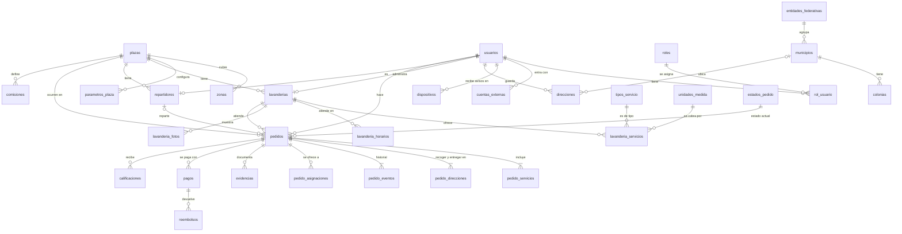

# Modelo de datos

La estructura completa de la base de datos, antes de escribir la primera migración. Arthur la pidió así: "apegarnos al
contrato […] pero la base de datos hay que dejarla con la posibilidad y la escalabilidad: que quede mutable pero bien
definida, normalizada, con una buena estructura y con buenas prácticas" (C-189). La decisión y sus alternativas
están en [[ADR-0016-modelo-de-datos]]. Arthur lo aprobó el 2026-11-20 para entrar a las specs (C-193).

## Lo que pide el contrato

- **Qué guarda la base:** "usuarios registrados, lavanderías, repartidores, pedidos, pagos e historial completo"
  (`NSV-2026-001-v8.pdf:20:ANEXO A, Sección A.3`).
- **Que crezca sin rediseñarse:** la arquitectura debe permitir "su expansión a plazas adicionales de la República
  Mexicana sin necesidad de reescritura del sistema ni de rediseño de la base de datos" (`NSV-2026-001-v8.pdf:4:
  Cláusula I`).
- **Lo que nunca guarda:** "Los números de tarjeta nunca se guardan en la plataforma" (`:20`). Las contraseñas "no se
  guardan en texto legible" (`:20`).
- **Quién ve qué:** "Un socio lavandería no puede consultar los datos de otro socio, ni los de los usuarios que no le
  han hecho pedidos" (`:20`).

## Las reglas del modelo

**Apego al contrato.** Cada tabla existe porque una función del contrato la necesita; la columna "Cita" lo dice. Lo
que el contrato excluye no tiene tabla (la verificación documental del repartidor, `:18`). Lo que todavía no se
decide no se adivina: la tabla nace cuando su fila de la deuda se responde.

**Normalizado (tercera forma normal).**
1. Cada dato vive en un solo lugar. Lo que se repite va en su propia tabla: los servicios de un pedido, sus dos
   direcciones, sus pagos y sus cambios de estado son filas, no columnas numeradas.
2. **Catálogos** para los valores que son datos y pueden crecer: roles, tipos de servicio, unidades de medida,
   estados del pedido y el territorio de la dirección (estados, municipios y colonias, C-238). Agregar uno es insertar
   una fila, no migrar.
3. **Restricciones `CHECK`** para los valores técnicos que solo cambian junto con el código: el estado de un pago, el
   método de pago, la plataforma de un teléfono.
4. **Solo dos excepciones, escritas a propósito:**
   - **La foto del pedido al crearse.** El pedido copia el precio y las direcciones del momento en que el usuario
     aceptó el resumen, antes de pagar (C-188). Si la lavandería cambia su precio después, el pedido no cambia. Es
     historial, no duplicado.
   - **El estado actual en `pedidos`.** Se guarda además del historial de `pedido_eventos`, en la misma transacción,
     para que la lista en tiempo real no recorra el historial cada 30 segundos (ADR-0007).

**Mutable sin rediseño.** Lo que el contrato pide hoy, construido de forma que lo siguiente sea una fila o una tabla
nueva, nunca un cambio de lo existente:

| Si mañana… | Se hace con | Sin tocar |
|---|---|---|
| Se abre otra plaza (`:4:Cláusula I`, por Orden de Cambio) | Filas en `plazas`, `zonas` y `parametros_plaza` | Ninguna tabla |
| Una cuenta necesita dos roles (DD-053) | Otra fila en `rol_usuario` | `usuarios` |
| Entra un servicio nuevo, como el calzado (DD-046, por Orden de Cambio) | Una fila en `tipos_servicio` | `lavanderia_servicios`, `pedido_servicios` |
| Se cobra por pieza el lavado en seco (DD-010) | Una fila en `unidades_medida` | Los precios ya guardados |
| Un pedido lleva varios servicios (DD-098) | Varias filas en `pedido_servicios` | `pedidos` |
| Se cobra una diferencia al pesar (DD-012) | Otra fila en `pagos` con tipo `ajuste` | `pedidos` |
| Cambia la comisión (DD-020) | Una fila nueva en `comisiones` con su fecha de inicio; la anterior queda como historial | Los pedidos ya cobrados |
| Se califica también al repartidor (DD-052: Nadir dijo que sí, C-200; falta asentarlo con el cliente) | Filas con `id_repartidores` en `calificaciones` | La tabla |
| Se aprueba la verificación documental del repartidor (`:18`, Orden de Cambio) | Una tabla nueva `documentos_repartidor` | `repartidores` |

**Buenas prácticas.**
- **Llaves.** La llave primaria es un `bigint` autoincremental que se llama `id_<tabla>`: `id_pedidos`,
  `id_tipos_servicio` (C-190). Va en minúsculas, porque PostgreSQL convierte a minúsculas los nombres sin comillas.
  **Todo identificador empieza con `id_` y nunca termina en `_id`** (C-194). Lo que sale por la API se identifica con
  `id_publico`, un ULID: así nadie adivina el pedido o la cuenta de otro cambiando un número (`:20`, separación por
  tipo de usuario). Lo que asigna la pasarela es `id_pasarela_<cosa>`: `id_pasarela_orden`, `id_pasarela_evento`.
- **Ningún nombre de proveedor de pagos** en tablas ni columnas (C-192): `eventos_pasarela`, `id_pasarela_orden` y una
  columna `pasarela` donde haga falta saber cuál cobró. La pasarela del contrato es Conekta hasta que el cliente firme el cambio; Stripe y Mercado Pago son candidatas
  (C-192, C-216, DD-079);
  cambiarla no toca la base.
- **Llaves foráneas en todas las relaciones,** con su índice. La foránea lleva el mismo nombre que la llave a la que
  apunta: `pedidos.id_usuarios` apunta a `usuarios.id_usuarios`. `ON DELETE RESTRICT` por omisión: el historial no se
  borra en cascada.
- **La plaza no puede diferir.** Toda tabla de operación lleva `id_plazas`, no nula (`modelo-multi-plaza.md`). Solo
  cinco la llevan opcional:
  - `avisos_masivos`: vacía, el aviso es para todas las plazas;
  - `comisiones`: vacía, junto con la lavandería, en la comisión global, que es una para todo el sistema (decisión 39
    del acta del 2026-11-20);
  - `reportes_soporte`: vacía solo si la cuenta no tiene de dónde tomarla; el reporte se guarda igual
    (perfil-usuario-E17, decisión 39);
  - `repartidores`: vacía si el repartidor está `pendiente`, o si está de `baja` con `aprobado_en` vacía: el registro
    que EL CLIENTE no autorizó (repartidor-E31);
  - `direcciones`: vacía si el punto no cae en ninguna zona. Cuando la tabla
  es hija de otra que ya la lleva, la llave foránea es compuesta, `(id_lavanderias, id_plazas)` contra
  `lavanderias(id_lavanderias, id_plazas)`: así la base de datos impide un pedido de Durango con una lavandería de La Laguna.
- **Borrado suave** (`deleted_at`) en cuentas, lavanderías, repartidores y direcciones. Pedidos, pagos y eventos no
  se borran nunca: son el "historial completo" (`:20`).
- **Dinero** en `numeric(12,2)` y en pesos; porcentajes en `numeric(5,2)`; cantidades en `numeric(8,2)`. Nunca
  `float`.
- **Horas** en `timestamptz`, como instante absoluto. Se muestran en la zona horaria de la plaza. Las horas del día de
  un horario (`lavanderia_horarios.hora_inicio` y `hora_fin`) son `time`, porque no son un instante.
- **Fecha de alta y de cambio:** toda tabla del negocio lleva `created_at` y `updated_at` en `timestamptz`, con su
  nombre de Laravel, como `deleted_at`. No los llevan `rol_usuario` ni `actividad_usuarios`, que no tienen llave
  propia y no se editan.
- **Una llave hacia una tabla que todavía no existe.** Si una tabla nace antes que la tabla a la que apunta, la columna
  nace opcional y sin llave foránea, y la llave la agrega el cambio que se nombra en "Nace en". Pasa con
  `calificaciones` y `pedidos` hacia `repartidores`, y con `calificaciones` hacia `pedidos`.
- **Mapas** en PostGIS (ADR-0004): puntos y polígonos `geography` con SRID 4326 e índice GiST.
- **Integridad en la base, no solo en el código:** únicos (correo, folio por plaza, `id_publico`) y `CHECK` (estrellas
  de 1 a 5, montos y porcentajes en rango, ventana que termina después de empezar).
- **Nombres:** tablas y columnas en español, en `snake_case`, tablas en plural (`CLAUDE.md` §6). Las tablas del
  framework conservan su nombre (`migrations`, `jobs`, `job_batches`, `failed_jobs`, `cache`, `sessions`,
  `personal_access_tokens`, `password_reset_tokens`, y las de la exportación de Filament: `exports`, `imports`,
  `failed_import_rows` y `notifications`). La tabla `users` de Laravel no se crea: su lugar es `usuarios`. Como el pluralizador de Laravel es inglés y Eloquent espera
  `id` y `<singular>_id`, **cada modelo declara su `$table` y su `$primaryKey`** (`Direccion` → `direcciones`, con
  `id_direcciones`), y cada relación nombra sus llaves.
- **Fotos y evidencias** en S3; en la base, solo la ruta (ADR-0006).
- **Migraciones solo hacia adelante,** una por cambio de OpenSpec. Una columna nueva entra como opcional o con valor
  por omisión, para no romper las filas que ya existen.

## El diagrama

## Las tablas

"Nace en" es el cambio de OpenSpec que crea la tabla con su migración. ⛔ marca una tabla que espera una fila de la
deuda: no se crea hasta que se responda.

### Catálogos

| Tabla | Columnas | Reglas | Cita | Nace en |
|---|---|---|---|---|
| `roles` | `id_roles`, `codigo`, `nombre` | `codigo` único. Semilla: `usuario`, `lavanderia`, `repartidor`, `administracion` | `:20` (separación por tipo de usuario); `:16-19` (cuatro módulos) | `registro-e-inicio-de-sesion` |
| `tipos_servicio` | `id_tipos_servicio`, `codigo`, `nombre`, `activo` | `codigo` único. Semilla: los tres del contrato, `estandar`, `planchado`, `seco` | `:16:A.3 #6` | `perfil-de-lavanderia` |
| `unidades_medida` | `id_unidades_medida`, `codigo`, `nombre` | `codigo` único. Semilla: `kg`. La pieza entra solo si DD-010 la pide | `:16:A.3 #5` ("precios por kilo") | `perfil-de-lavanderia` |
| `estados_pedido` | `id_estados_pedido`, `codigo`, `nombre_usuario`, `orden`, `visible_usuario` | `codigo` único. Semilla: los cinco del usuario, Confirmado, Recolectado, En proceso, Listo y Entregado, más los internos que fije el ADR de la máquina de estados (DD-123) | `:17:A.3 #12`; Módulos B #3 y C #3 | `resumen-y-confirmacion` |
| `entidades_federativas` | `id_entidades_federativas`, `codigo`, `nombre` | Los estados del territorio. `codigo` único, dos números (`CHECK`): la clave del estado en el catálogo de Correos de México. Sin semilla: la carga el comando `direcciones:cargar-catalogo` desde el archivo, que no se versiona (DD-138) | `:4:Cláusula I`; `:16:A.3 #8`; C-238 | `direcciones` |
| `municipios` | `id_municipios`, `id_entidades_federativas`, `codigo`, `nombre` | Los del territorio de `config/territorio.php`: todos los de Durango y, de Coahuila, Torreón y Matamoros. `codigo` único, cinco números (`CHECK`): la clave del estado y la del municipio; es como la API lo nombra. Nunca se borra: las direcciones lo apuntan | `:4:Cláusula I`; `:16:A.3 #8`; C-238 | `direcciones` |
| `colonias` | `id_colonias`, `id_municipios`, `codigo_postal`, `nombre`, `tipo` | Una fila por asentamiento del archivo. `codigo_postal` de cinco números (`CHECK`), con índice. Sin único por nombre. Solo sugiere la colonia: ninguna tabla la apunta y la carga la reemplaza por municipio | `:16:A.3 #8`; C-238 | `direcciones` |

### Geografía y plazas

| Tabla | Columnas | Reglas | Cita | Nace en |
|---|---|---|---|---|
| `plazas` | `id_plazas`, `nombre`, `zona_horaria`, `activa` | `nombre` único, para que recargar una plaza no la duplique. Una plaza nueva es una fila. Abrirla fuera del territorio inicial es Orden de Cambio | `:4:Cláusula I` | `plazas-y-zonas` |
| `zonas` | `id_zonas`, `id_plazas`, `nombre`, `poligono` (`geography(MultiPolygon)`), `activa` | Índice GiST. Único `(id_plazas, nombre)`. Fuente del polígono: los límites municipales del Marco Geoestadístico del INEGI (decisión 62 de `acta-2026-11-20-modelo-y-pasarela.md`); qué cubre cada zona, DD-094 | `:4:Cláusula I`; `:15:A.2`, sección 7 | `plazas-y-zonas` |
| `parametros_plaza` | `id_parametros_plaza`, `id_plazas`, `clave`, `valor` (`jsonb`), `vigente_desde`, `vigente_hasta` | Las reglas comerciales que el contrato deja abiertas y cambian con el tiempo: envío (DD-019, DD-025), anticipación y horizonte de la agenda (DD-099), texto de la cancelación (DD-016). Cada `clave` se valida en el código; único `(id_plazas, clave, vigente_desde)` | `:19:Módulo D`; `modelo-multi-plaza.md` | `plazas-y-zonas` |
| `direcciones` | `id_direcciones`, `id_publico`, `id_usuarios`, `id_plazas`, `alias`, `calle`, `numero_exterior`, `numero_interior`, `colonia`, `codigo_postal`, `referencias`, `ubicacion` (`geography(Point)`), `es_favorita`, `deleted_at`, `id_municipios` | La colonia es obligatoria. La plaza sale de la zona que contiene el punto; vacía si el punto no cae en ninguna zona. Único `(id_direcciones, id_plazas)`, para la llave compuesta de `pedido_direcciones`. El municipio es la llave al catálogo, `id_municipios`, opcional (la API la exige en la escrita); el estado sale de él. La columna de texto `municipio` salió con la dirección asistida (decisión 29 del acta del 2026-11-20). La colonia y el código postal siguen siendo texto: el catálogo los sugiere y no los exige | `:16:A.3 #8`; C-238 | `direcciones` |

### Cuentas y acceso

| Tabla | Columnas | Reglas | Cita | Nace en |
|---|---|---|---|---|
| `usuarios` | `id_usuarios`, `id_publico`, `nombre`, `correo`, `password` (opcional si entra con Google o Apple), `telefono`, `foto_ruta`, `estado` (`activo`, `bloqueado`), `bloqueado_en`, `deleted_at` | Toda cuenta, de cualquier rol. Sin fecha de aceptación de términos: los consentimientos son de EL CLIENTE (Cláusula X; decisión 39). Correo único sin distinguir mayúsculas. La contraseña, con hash. Sin `id_plazas`: la persona no pertenece a una plaza, su dirección sí | `:16:A.3 #2`; `:17:A.3 #15`; `:18:Módulo C #1`; `:19:Módulo D #3`; `:20` | `registro-e-inicio-de-sesion` |
| `rol_usuario` | `id_usuarios`, `id_roles` | Llave compuesta. En la v1, una cuenta tiene un rol (DD-053), y lo impone el código, no la tabla | `:20` | `registro-e-inicio-de-sesion` |
| `cuentas_externas` | `id_cuentas_externas`, `id_usuarios`, `proveedor` (`google`, `apple`), `sujeto`, `correo` | Único `(proveedor, sujeto)`. Un proveedor nuevo es otra fila, no otra columna | `:16:A.3 #2`; ADR-0005 | `registro-e-inicio-de-sesion` |
| `dispositivos` | `id_dispositivos`, `id_usuarios`, `token_fcm`, `plataforma` (`ios`, `android`), `ultimo_uso_en` | `token_fcm` único | `:19` (avisos); ADR-0008 | `avisos` |
| `actividad_usuarios` | `id_usuarios`, `fecha` | Llave compuesta: una fila por persona y día. Alimenta "usuarios activos" (DD-111) | `:46:ANEXO D, Sección D.5`; `:22:A.5` | `indicadores` |

### Lavanderías y repartidores

| Tabla | Columnas | Reglas | Cita | Nace en |
|---|---|---|---|---|
| `lavanderias` | `id_lavanderias`, `id_publico`, `id_plazas`, `id_usuarios`, `nombre`, `descripcion`, `telefono`, `calle`, `numero`, `colonia`, `codigo_postal`, `ubicacion` (`geography(Point)`), `estado` (`pendiente`, `activa`, `suspendida`, `baja`), `aprobada_en`, `deleted_at`, `id_municipios` | Único `(id_lavanderias, id_plazas)`, para las llaves compuestas de sus hijas. Índice GiST en `ubicacion`. `estado` vale `activa` por omisión; el registro de la app pone el suyo. La baja es `estado = 'baja'`, sin `deleted_at`. `id_municipios` es la llave opcional al catálogo, como en `direcciones`: la geocodificación de la dirección la necesita, y la API la exige en el registro; las lavanderías de prueba no la tienen | `:17:Módulo B #1`; `:19:Módulo D #1`; `:16:A.3 #3 y #5`; C-238 | `perfil-de-lavanderia` (de prueba); `alta-de-lavanderias` (alta real, el valor por omisión de `estado` e `id_municipios`) |
| `lavanderia_servicios` | `id_lavanderia_servicios`, `id_lavanderias`, `id_plazas`, `id_tipos_servicio`, `id_unidades_medida`, `precio`, `activo` | Único `(id_lavanderias, id_tipos_servicio)`. `precio >= 0`. Quién fija el precio: DD-010 | `:16:A.3 #5 y #6`; `:17:Módulo B #1` | `perfil-de-lavanderia` |
| `lavanderia_horarios` | `id_lavanderia_horarios`, `id_lavanderias`, `id_plazas`, `dia_semana` (1 a 7), `hora_inicio`, `hora_fin` | `hora_fin > hora_inicio`. El cupo por ventana entra como columna cuando DD-099 diga cuánto; los festivos, con DD-078 | `:17:Módulo B #1 y #6` | `perfil-de-lavanderia` (**hueco de hoy:** ninguna spec la creaba) |
| `lavanderia_fotos` | `id_lavanderia_fotos`, `id_lavanderias`, `id_plazas`, `ruta`, `orden` | La foto vive en S3 | `:16:A.3 #5`; `:17:Módulo B #1`; `:20` | `perfil-de-lavanderia` |
| `repartidores` | `id_repartidores`, `id_publico`, `id_plazas`, `id_usuarios`, `tipo_vehiculo`, `estado` (`pendiente`, `activo`, `suspendido`, `baja`), `aprobado_en`, `deleted_at` | Nombre, teléfono, correo y foto viven en `usuarios`. Único `(id_repartidores, id_plazas)`. `id_plazas` vacía si `estado` es `pendiente`, o si es `baja` con `aprobado_en` vacía: el registro que EL CLIENTE no autorizó (repartidor-E31) (`CHECK`). `id_usuarios` única: una cuenta es a lo más un repartidor. `estado` vale `pendiente` por omisión: así nace el registro de la app. La migración también agrega las llaves de `pedidos.id_repartidores` y `calificaciones.id_repartidores`. **No tiene columnas de documentos:** la verificación documental está excluida (`:18`) | `:18:Módulo C #1`; `:19:Módulo D #2` | `repartidor` |

### Pedidos

| Tabla | Columnas | Reglas | Cita | Nace en |
|---|---|---|---|---|
| `pedidos` | `id_pedidos`, `id_publico`, `id_plazas`, `folio`, `id_usuarios`, `id_lavanderias`, `id_repartidores`, `id_estados_pedido`, `ventana_inicio`, `ventana_fin`, `monto_estimado`, `monto_final`, `envio`, `comision_porcentaje`, `confirmado_en`, `cancelado_en` | Único `(id_plazas, folio)`; formato del folio: DD-101. Único `(id_pedidos, id_plazas)`, para las llaves compuestas de sus hijas. Llave compuesta con la plaza hacia `lavanderias`; `id_repartidores` nace sin llave y `repartidor` le agrega la compuesta. `comision_porcentaje` queda vacía hasta que exista `comisiones` (`administracion`, DD-020). `ventana_fin > ventana_inicio`. Con C-188, `confirmado_en` se llena cuando la pasarela confirma el pago | `:16:A.3 #7, #9 y #10`; `:17:A.3 #11 y #12` | `resumen-y-confirmacion` |
| `pedido_servicios` | `id_pedido_servicios`, `id_pedidos`, `id_plazas`, `id_tipos_servicio`, `id_unidades_medida`, `cantidad_estimada`, `cantidad_real`, `precio_unitario`, `monto_estimado`, `monto_real` | El precio se copia al crear el pedido. `monto_estimado` y `monto_real` son columnas generadas (`cantidad_estimada` o `cantidad_real` × `precio_unitario`), no se capturan. Uno o varios por pedido: DD-098 | `:16:A.3 #6 y #9` | `resumen-y-confirmacion` |
| `pedido_direcciones` | `id_pedido_direcciones`, `id_pedidos`, `id_plazas`, `tipo` (`recoleccion`, `entrega`), `id_direcciones`, las columnas de la dirección y `ubicacion` | La dirección se copia al crear el pedido; `id_direcciones` guarda de cuál salió, con llave compuesta con la plaza. Único `(id_pedidos, tipo)`. `municipio` sigue siendo texto: la copia lleva el nombre que el municipio tenía en el catálogo, sin el estado | `:16:A.3 #8` | `resumen-y-confirmacion` |
| `pedido_eventos` | `id_pedido_eventos`, `id_pedidos`, `id_plazas`, `id_estados_pedido`, `id_usuarios` (quien hizo el cambio), `motivo`, `ocurrido_en` | Solo se agrega, nunca se edita. Guarda el rechazo de la lavandería con su motivo. Mide los 60 s del A.4.3 y alimenta los indicadores | `:17:A.3 #12`; Módulo B #2 y #3; `:20` ("historial completo"); `:21:A.4.3` | `resumen-y-confirmacion` (base); `estados-del-pedido` |
| `pedido_asignaciones` | `id_pedido_asignaciones`, `id_pedidos`, `id_plazas`, `id_repartidores`, `estado` (`ofrecido`, `aceptado`, `rechazado`), `motivo`, `respondido_en` | El repartidor acepta o rechaza con motivo; cada intento es una fila. `respondido_en` vacía solo si `estado` es `ofrecido`, y el rechazo lleva `motivo` no vacío (`CHECK`). La hora de la oferta es `created_at`. Quién asigna: DD-014 | `:18:Módulo C #2` | `repartidor` |
| `evidencias` | `id_evidencias`, `id_pedidos`, `id_plazas`, `tipo` (solo `entrega`), `ruta`, `id_usuarios` (quien la tomó), `tomada_en` | La foto vive en S3. Si es obligatoria, y si también se toma al recolectar (la propuesta de Arthur, C-241): DD-110. El tipo `recoleccion` se quitó por no tener respaldo (decisión 39) | `:20` ("evidencias de entrega"); ADR-0006 | `repartidor` |
| `calificaciones` | `id_calificaciones`, `id_pedidos`, `id_plazas`, `id_usuarios`, `id_lavanderias`, `id_repartidores`, `estrellas`, `comentario` | `estrellas` de 1 a 5. Exactamente uno de `id_lavanderias` o `id_repartidores`. Única por pedido y calificado. La fecha de la reseña es `created_at` | `:17:A.3 #14`; Módulo B #4; Módulo C #4 | `perfil-de-lavanderia` (base, sin las llaves a `pedidos` ni a `repartidores`); `historial-y-calificacion` (la llave a `pedidos`, el `CHECK` de exactamente uno y los únicos); `repartidor` (la llave a `repartidores`) |

### Dinero

| Tabla | Columnas | Reglas | Cita | Nace en |
|---|---|---|---|---|
| `pagos` | `id_pagos`, `id_publico`, `id_pedidos`, `id_plazas`, `tipo` (`cobro`, `ajuste`), `metodo` (`tarjeta`, `efectivo`), `pasarela`, `monto`, `estado` (`pendiente`, `pagado`, `vencido`, `fallido`, `cancelado`), `id_pasarela_orden`, `referencia_efectivo`, `vence_en`, `pagado_en` | Ningún dato de tarjeta. `pasarela` dice cuál cobró: `conekta` mientras el cliente no firme el cambio; la elegida, si se firma (DD-079). Único `(pasarela, id_pasarela_orden)` y `(id_pagos, id_plazas)`. Un pedido puede tener un cobro y, si DD-012 lo pide, un ajuste | `:16:A.3 #10`; `:19`; `:20` | `pago` |
| `reembolsos` | `id_reembolsos`, `id_pagos`, `id_plazas`, `monto`, `motivo`, `id_pasarela_reembolso`, `estado` (`pendiente`, `reembolsado`, `fallido`), `reembolsado_en` | `monto` no mayor que lo pagado. La pasarela es la de su pago. Cuándo se reembolsa: DD-012, DD-016 y DD-103 | `:16:A.3 #9` (cancelación); `:19:Módulo D #6` | `pago` |
| `eventos_pasarela` | `id_eventos_pasarela`, `pasarela`, `id_pasarela_evento`, `tipo`, `contenido` (`jsonb`), `recibido_en`, `procesado_en`, `error` | Único `(pasarela, id_pasarela_evento)`: un aviso repetido no se procesa dos veces | `:19`; ADR-0010 (Conekta; se reemplaza si el cliente firma el cambio, DD-079) | `pago` |
| `comisiones` | `id_comisiones`, `id_plazas`, `id_lavanderias`, `porcentaje`, `vigente_desde`, `vigente_hasta` | La global va sin plaza ni lavandería y es una para todo el sistema ("por socio o global", decisión 39); la propia lleva las dos, con llave compuesta hacia `lavanderias` (`CHECK`). Porcentaje de 0 a 100. La vigencia termina después de empezar. A lo más una global abierta (sin `vigente_hasta`) en todo el sistema y una por lavandería: un cambio cierra la anterior y agrega otra fila. Sin semilla | `:19:Módulo D #5` | `administracion` |
| ⛔ `metodos_pago_guardados` | `id_metodos_pago_guardados`, `id_usuarios`, `pasarela`, `id_pasarela_cliente`, `id_pasarela_fuente`, `marca`, `ultimos_4`, `deleted_at` | Solo la referencia que da la pasarela | `:17:A.3 #15`; `:20` | `perfil-y-soporte`: Nadir dijo que sí (C-198); espera saber si el checkout permite reutilizar la tarjeta (pago-E06, DD-079) |
| `movimientos_pasarela` | `id_movimientos_pasarela`, `pasarela`, `id_pasarela_orden`, `monto`, `comision`, `pagado_en` | Los pagos que acreditó la pasarela, leídos de su API al conciliar un periodo. Una fila por orden: único `(pasarela, id_pasarela_orden)`; leer otra vez actualiza la fila. `pasarela` con los valores de `pagos`; `monto` mayor que cero; `comision` opcional, no negativa (quién la absorbe: DD-013). **Sin `id_plazas` ni llave a `pagos`:** la plaza es la del pedido con el que cuadra y un movimiento sin pedido es una diferencia; va en la lista `sin_plaza` de `config/modelo.php`. Ningún dato de tarjeta | `:19:Módulo D #6`; segunda adenda del 2026-11-22 de ADR-0010 | `administracion` |

### Comunicación y soporte

| Tabla | Columnas | Reglas | Cita | Nace en |
|---|---|---|---|---|
| `reportes_soporte` | `id_reportes_soporte`, `id_usuarios`, `id_pedidos`, `id_plazas`, `mensaje`, `estado`, `atendido_en` | `id_plazas` sale del pedido; sin pedido, del último pedido de la cuenta o de su dirección guardada más reciente (decisión 27 del acta del 2026-11-20). Si la cuenta no tiene de dónde tomarla, queda vacía y el reporte se guarda igual; lo ve solo la administración. Un reporte con pedido siempre lleva plaza (`CHECK`) (decisión 39). A quién llega: DD-108 | `:17:A.3 #16` | `perfil-y-soporte` |
| `avisos_masivos` | `id_avisos_masivos`, `id_plazas`, `segmento` (`jsonb`), `titulo`, `mensaje`, `id_usuarios` (quien lo envió), `enviado_en`, `destinatarios` | `id_plazas` vacía: el aviso es para todas las plazas. `segmento` vacío: sin segmento. `enviado_en` es cuándo lo envió la administración. `destinatarios` es el número de teléfonos a los que salió (`integer`, no negativo), vacío hasta que sale. Los segmentos: DD-113 | `:19:Módulo D #7` | `administracion` |

### Landing

| Tabla | Columnas | Reglas | Cita | Nace en |
|---|---|---|---|---|
| `testimonios` | `id_testimonios`, `autor`, `texto`, `activo`, `orden` | Las opiniones de la sección 8 de la portada, que se editan en el panel con su interruptor de activo y su orden (ADR-0011). `autor` y `texto` no nulos ni en blanco (`CHECK`). `activo` vale `false` por omisión: un testimonio nuevo no se publica hasta activarlo. `orden` es `smallint`, 0 por omisión y no negativo (`CHECK`). **Sin `id_plazas`:** la portada es una para todo el sitio; va en la lista `sin_plaza` de `config/modelo.php` (modelo-E05). Sin el trigger `impedir_cambio()`: es contenido, no historial | `:15:A.2`, sección 8; ADR-0011 | `landing` |
| `logos_prensa` | `id_logos_prensa`, `nombre`, `imagen`, `activo`, `orden` | Los logos de medios o menciones de la sección 10 de la portada, que se editan en el panel con su interruptor de activo y su orden (ADR-0011). `nombre` es el del medio y es también el texto alternativo de la imagen. `imagen` es la ruta del archivo en el disco privado de fotos del entorno, y la portada la recibe por una ruta pública del servidor (adenda del 2026-11-24 de ADR-0006). `nombre` e `imagen` no nulos ni en blanco (`CHECK`). `activo` vale `false` por omisión: un logo nuevo no se publica hasta activarlo. `orden` es `smallint`, 0 por omisión y no negativo (`CHECK`). **Sin `id_plazas`:** la portada es una para todo el sitio; va en la lista `sin_plaza` de `config/modelo.php` (modelo-E05). Sin el trigger `impedir_cambio()`: es contenido, no historial | `:15:A.2`, sección 10; ADR-0011 | `landing` |

**Los indicadores no tienen tablas propias.** Se calculan de `pedidos`, `pedido_eventos`, `pagos`, `calificaciones` y
`actividad_usuarios`. Si una consulta resulta lenta, se agrega una vista materializada, que no cambia ninguna tabla
(DD-116).

**Lo que no tiene tabla todavía, a propósito:**
- `documentos_repartidor`: excluido por el contrato (`:18`). Si entra por Orden de Cambio, es una tabla nueva.
- El cupo por ventana (DD-099) y los festivos (DD-078): entran cuando se decidan, como columnas opcionales o tablas
  nuevas. Los demás textos de la landing no tienen tabla: salen de la configuración
  (`openspec/changes/landing/design.md`).

## Lo que falta decidir y toca el modelo

| Fila | Qué cambia en el modelo |
|---|---|
| DD-123 | La máquina de estados del pedido: qué estados internos lleva `estados_pedido` y qué transiciones permite el código |
| DD-012 | Cómo se calcula `cantidad_estimada` antes de recolectar y si existe el pago de tipo `ajuste` |
| DD-053 | Si una cuenta puede tener más de un rol: la tabla ya lo permite; el código lo limita a uno |
| DD-099 | La columna de cupo en `lavanderia_horarios` |
| DD-101 | El formato del folio |
| DD-055 | Nadir dijo que sí (C-198): se guarda solo la referencia. Falta saber si el checkout de la pasarela permite reutilizar la tarjeta (ADR-0010, punto 5; DD-079) para crear `metodos_pago_guardados` |
| DD-079 | Los valores de `pasarela`: `conekta` mientras no se firme el cambio; la elegida, si se firma (C-216) |
| DD-093 y DD-094 | Las filas semilla de `plazas` y `zonas` |
