# Auditoría Lavandi — Segmento 3: Base de datos y escalabilidad

**Objeto:** rama `arthur/feat/h3-concilio` (PR #4) · SHA `9d24977` · fecha de corte 2026-11-24.

**Qué NO se revisó:**
- No se corrieron las migraciones, las pruebas ni ninguna prueba de carga. **No se afirma cuántos usuarios aguanta.**
  Todo lo de escalabilidad se razona desde el código.
- El árbol no trae `vendor/`. Lo que depende del comportamiento interno de Filament, por ejemplo si carga solo una
  relación en una columna, quedó sin confirmar y así se marca.

**Veredicto: LISTO CON RESERVAS.**
- El modelo de datos es sólido para la integridad:
  - es multi-plaza en la base, con llaves compuestas `(id, id_plazas)` y `ON DELETE RESTRICT`;
  - tiene unos 30 CHECK;
  - triggers impiden borrar pedidos, pagos y reembolsos, y editar el historial del pedido.
- Las reservas son de crecimiento. Las consultas por fecha no tienen índice y aplican funciones sobre la columna. Los
  indicadores se recalculan cada 30 s sin caché. Hay listados sin paginación que crecen con el uso. Hay tablas que nadie
  limpia.
- Nada de esto rompe el contrato hoy, pero pesa sobre el costo mensual de referencia del B.4 (RN-22).

### Resumen

- **Motor:** PostgreSQL con PostGIS. La CI usa `postgis/postgis:17-3.5` y `phpunit.xml` usa `pgsql`. Hay 34
  migraciones, solo hacia adelante (ADR-0016, regla 9), y 39 tablas de negocio, además de las de Laravel.
- **Plaza:** toda tabla de operación lleva `id_plazas` con llave a `plazas`, y lo prueba plazas-E09. Las tablas sin
  plaza están declaradas una por una en `servidor/config/modelo.php:49-71`.
- **Integridad fuerte:**
  - el folio es único por plaza;
  - hay un solo cobro por pedido (índice parcial);
  - el correo es único sin distinguir mayúsculas;
  - el webhook es único por evento de la pasarela;
  - el estado actual del pedido (`pedidos.id_estados_pedido`) y su evento se escriben en la misma transacción.
- **Riesgos de crecimiento:**
  - los 10 widgets de indicadores se refrescan cada 30 s sin caché ni índice;
  - el historial del usuario, de la lavandería y del repartidor, las reseñas, y las lavanderías cercanas sin radio no
    tienen paginación;
  - el mapa del monitoreo acumula los pedidos rechazados;
  - las estadísticas de los socios cuentan toda la historia para sacar "hoy" y "esta semana".
- **Datos personales:** borrar la cuenta solo la marca como borrada (borrado suave). Los datos, la foto y el correo se
  quedan, y el correo ya no se puede volver a registrar. Lo que debe pasar con esos datos espera a DD-109.

### Hallazgos

| ID | Severidad | Área | Hallazgo | Evidencia (grado + ruta:línea) | Impacto | Recomendación |
|---|---|---|---|---|---|---|
| S3-01 | Media | Indicadores | **Los 10 widgets se refrescan cada 30 s, sin caché, y recorren las tablas.** Filtran con `(columna at time zone plazas.zona_horaria)::date`: depende de otra tabla, así que ni un índice de expresión sirve. Además, `confirmado_en`, `pagado_en` y `ocurrido_en` no tienen ningún índice. `MontoPromedio` no limita la fecha en el WHERE y lee toda la historia. "Pedidos totales" se calcula dos veces por refresco | B: `servidor/app/Filament/Widgets/Indicadores/Concerns/EsDeIndicadores.php:56-59`; `servidor/config/indicadores.php:24`; `servidor/app/Indicadores/MontoPromedio.php:33-44`; `PedidosTotales.php:23`; `PedidosTotalesGrafica.php:45` y `PedidosTotalesTabla.php:27`; ninguna migración indexa esas tres columnas (la búsqueda no dio nada) | El costo crece con cada pedido y con cada pestaña abierta del panel. Es la consulta más pesada del sistema contra una base de 259 a 864 MXN al mes (`NSV-2026-001-v8.pdf:29:ANEXO B, Sección B.4`, RN-22) | Columna de fecha local calculada al escribir, o rangos en UTC por plaza con índice en `(id_plazas, confirmado_en)`; caché corta por widget; quitar la consulta repetida |
| S3-02 | Media | Paginación | **Hay listados que crecen con el uso y devuelven todo:** historial del usuario, historial de la lavandería y del repartidor, reseñas del perfil y ficha del usuario en el panel. El historial de entregas ordena por un valor calculado con una subconsulta por fila | B: `servidor/app/Http/Controllers/Api/PedidosController.php:279-284` (`->get()`); `HistorialDeLaLavanderiaController.php:74-78`; `HistorialDelRepartidorController.php:55-59`; `PerfilDeLavanderiaController.php:77-79`; `servidor/app/Filament/Resources/Usuarios/HistorialDelUsuario.php:33-37`; `servidor/app/Models/Pedido.php:139-148` | Respuestas más pesadas cada mes, en un teléfono con datos móviles | Paginación por cursor en la API y en la app |
| S3-03 | Media | Monitoreo | **El mapa del monitoreo carga todos los pedidos "activos" cada 30 s, sin límite.** Los rechazados cuentan como activos y no tienen transición de salida, así que se acumulan para siempre. La tabla y el mapa repiten la consulta | B: `servidor/app/Models/Pedido.php:119-126` (`RECHAZADO` dentro de `activosDelMonitoreo`); `servidor/app/Pedidos/CambioDeEstado.php:64-73` (sin salida desde rechazado); `servidor/app/Filament/Pages/MonitoreoDePedidos.php:86,94-100`; `servidor/app/Pedidos/MarcadoresDelMonitoreo.php:42-45` | El mapa se llena de pedidos muertos y la consulta crece sin cota. También ensucia A43-7 | Decidir qué pasa con el rechazado (DD-016, BR-22) y sacarlo del monitoreo; limitar el mapa |
| S3-04 | Media | Consultas frecuentes | **Las consultas que corren cada 30 s o en cada búsqueda no tienen la cota que necesitan.** (a) Las estadísticas de los socios cuentan toda la historia para sacar el día y la semana. (b) Las lavanderías cercanas, sin `distancia_maxima_metros`, devuelven todas las de la plaza, y en cada llamada agregan toda la tabla `calificaciones`. (c) La lista de la lavandería recorre todos sus pedidos históricos y filtra el estado después | B: `servidor/app/Pedidos/EstadisticasDeLaLavanderia.php:36-53`; `servidor/app/Repartidores/EstadisticasDelRepartidor.php:37-54`; `LavanderiasCercanasRequest.php:28`; `servidor/app/Lavanderias/ConsultaDeCercanas.php:44-49,72-81`; `servidor/app/Autorizacion/Autorizacion.php:330-340` | Crece con la historia de cada socio; F-A03 todavía no define "cercana" (DD-083) | Acotar las estadísticas por fecha en el WHERE; un radio por omisión cuando se cierre DD-083; precalcular la calificación promedio; índice `(id_lavanderias, id_estados_pedido)` |
| S3-05 | Media | Transacciones | **La subida de fotos a S3 ocurre dentro de transacciones que tienen filas bloqueadas:** en la edición y el alta de lavanderías y en el alta de repartidores. Se suma al checkout de Conekta del segmento 2 (S2-02) | B: `servidor/app/Lavanderias/EdicionDeLavanderia.php:56-84`; `RegistroDeLavanderia.php:53-70`; `servidor/app/Repartidores/RegistroDeRepartidor.php:50-54` | Conexiones y bloqueos retenidos mientras dura la subida a la red | Subir antes de abrir la transacción, como ya lo hace la evidencia de entrega (`EvidenciaDeEntrega.php:41-44`) |
| S3-06 | Media | Datos personales | **Borrar la cuenta es solo un borrado suave.** Los datos y la foto se quedan, y el correo queda ocupado para siempre por el único sin distinguir mayúsculas. La relación con lo que piden las tiendas y con la ley de datos espera a DD-109 | B: `servidor/app/Identidad/BorradoDeCuenta.php:14-35`; `servidor/database/migrations/2026_11_20_200000_crear_roles_usuarios_y_cuentas_externas.php:66-67`; `servidor/app/Models/Usuario.php:49`. A: `NSV-2026-001-v8.pdf:10:Cláusula X` (encargado del tratamiento) | La persona no puede volver a registrarse con su correo; datos personales sin plazo de retención | Que EL CLIENTE, como responsable, decida la retención (DD-109) y que el borrado la aplique (lo amplía el segmento 4) |
| S3-07 | Media | Colas | **El aviso masivo no se reparte por lotes.** Un solo job toma todos los teléfonos con `pluck` y despacha un job por teléfono, sin `chunk` ni batch, con `tries = 1` y sin idempotencia: un `queue:retry` lo vuelve a mandar a todos. Un aviso FCM reintentado después de un envío que sí salió llega dos veces | B: `servidor/app/Avisos/MandarAvisoMasivo.php:30-42`; `servidor/app/Avisos/MandarAvisoAlTelefono.php:80-82` | Avisos duplicados a toda la base; memoria proporcional al número de teléfonos | Lotes con `chunkById` o `Bus::batch`; marcar lo enviado para que el reintento no repita |
| S3-08 | Baja | Mantenimiento | **Hay tablas que nadie limpia.** Los tokens de Sanctum no vencen (`expiration => null`) y no se podan. `failed_jobs`, `job_batches`, `notifications` y los vencidos de `cache` tampoco. El programador solo poda las exportaciones | B: `servidor/config/sanctum.php:53`; `servidor/routes/console.php:14` (única tarea) | Crecimiento sin cota; tokens válidos para siempre (lo amplía el segmento 4) | `sanctum:prune-expired` con expiración, `queue:prune-failed` y poda de notificaciones en el programador |
| S3-09 | Baja | Conciliación | La conciliación llama a la API de Conekta de forma síncrona, paginando desde la orden más reciente hasta el inicio del rango, y calcula el reporte dos veces por dibujo. Su exportación no tiene tope de rango y se arma completa en memoria | B: `servidor/app/Cobro/PasarelaConekta.php:164-197`; `servidor/app/Filament/Pages/Conciliacion.php:139-140`; `servidor/app/Exportacion/ExportadorDeIndicador.php:103,132-149` | Peticiones lentas en el panel con rangos largos | Pasarla a la cola, como la exportación; tope de rango |
| S3-10 | Baja | Usuarios activos | `actividad_usuarios` no tiene quien la escriba, y su llave primaria `(id_usuarios, fecha)` no sirve para filtrar por rango de fechas | B: `servidor/app/Indicadores/UsuariosActivos.php:25-32`; `servidor/database/migrations/2026_11_22_500000_crear_actividad_usuarios.php`; segmento 1, S1-06 | El indicador sale en cero (A43-7) | Escribirla en el middleware de la API; índice por `fecha` |
| S3-11 | Baja | N+1 | Un N+1 en `GET /socio/lavanderias` (un `load()` por lavandería) y una consulta de autorización por fila en la tabla de usuarios del panel. No hay `preventLazyLoading` | B: `servidor/app/Http/Controllers/Api/LavanderiaDelSocioController.php:163-166`; `servidor/app/Filament/Resources/Usuarios/Actions/AccionesDeBloqueo.php:39,58`; `Autorizacion.php:199-202` | Hoy N es pequeño | `Model::preventLazyLoading()` fuera de producción |
| S3-12 | Baja | Configuración | La conexión cae en SQLite si falta `DB_CONNECTION`, y el bloque `pgsql` no tiene `statement_timeout`. Ninguno de los 5 jobs declara `$timeout`. No está escrito cómo se despliega: `config:cache`, worker y programador | B: `servidor/config/database.php:20,87-99`; `servidor/config/queue.php:43`; la búsqueda en los README, `composer.json` y la CI no dio nada | Una consulta sin fin retiene la conexión; un despliegue que olvide el worker deja sin avisos ni correos | Valor por omisión `pgsql`; `statement_timeout`; un procedimiento de despliegue (DD-070) |
| S3-13 | Baja | Archivos | El servidor no comprime: solo la app reduce a 1600 px y JPEG 0.7, y el servidor acepta hasta 5 MB. No hay limpieza de archivos sin dueño y la foto de perfil queda al borrar la cuenta | B: `servidor/config/fotos.php:31-44`; `servidor/app/Fotos/AlmacenDeFotos.php:25-28,44-52`; `movil/src/configuracion/fotos.ts:12-16` | Costo de almacenamiento (RN-22) | Bajar el máximo a lo que produce la app; limpieza programada |
| S3-14 | Info | Restos | `config/modelo.php` nombra `metodos_pago_guardados`, una tabla que ninguna migración crea. Las migraciones llevan fechas posteriores al commit (hasta `2026_11_27`), y dos pares comparten marca de tiempo | B: `servidor/config/modelo.php:64`; `servidor/database/migrations/2026_11_27_200000_crear_logos_prensa.php`; `2026_11_22_100000_*` (2 archivos) y `2026_11_24_100000_*` (2) | Una migración nueva con fecha real puede quedar ordenada antes que estas | Quitar la entrada; fechar las migraciones con la fecha real |
| S3-15 | Info | Positivos verificados | Llaves compuestas con plaza en todas las hijas; `RESTRICT` en todas las llaves; triggers `impedir_cambio`; índices GiST en `lavanderias.ubicacion`, `zonas.poligono`, `direcciones.ubicacion` y `pedido_direcciones.ubicacion`; únicos parciales en pagos y comisiones; deduplicación del webhook | B: `servidor/database/migrations/2026_11_21_400000_crear_estados_y_pedidos.php:91-93,128-131,243-250`; `2026_11_24_100000_crear_pagos_reembolsos_y_eventos_pasarela.php:72,88`; `2026_11_22_200000_crear_comisiones_y_avisos_masivos.php` | — | — |

### Diagrama E-R (derivado de las migraciones de `9d24977`)

Lleva las llaves y las columnas que importan para leerlo, no todas. **PK** es llave primaria, **FK** llave foránea y
**UK** único. Las relaciones hacia `plazas` de las tablas hijas se omiten: toda tabla de operación la tiene y sus llaves
compuestas `(id, id_plazas)` la heredan del padre.

```mermaid
erDiagram
    plazas ||--o{ zonas : "tiene"
    plazas ||--o{ parametros_plaza : "configura"
    plazas ||--o{ lavanderias : "opera en"
    plazas ||--o{ pedidos : "ocurre en"
    plazas |o--o{ repartidores : "autorizado en"
    plazas |o--o{ comisiones : "aplica en"
    plazas |o--o{ avisos_masivos : "segmenta"

    usuarios ||--o{ rol_usuario : ""
    roles ||--o{ rol_usuario : ""
    usuarios ||--o{ cuentas_externas : "Google o Apple"
    usuarios ||--o{ dispositivos : "token FCM"
    usuarios ||--o{ actividad_usuarios : "dia activo"
    usuarios ||--o{ direcciones : "guarda"
    usuarios ||--o{ pedidos : "pide"
    usuarios ||--o{ lavanderias : "es socio de"
    usuarios ||--o| repartidores : "es"
    usuarios ||--o{ reportes_soporte : "reporta"
    usuarios ||--o{ calificaciones : "califica"
    usuarios ||--o{ exports : "descarga"

    entidades_federativas ||--o{ municipios : ""
    municipios ||--o{ colonias : "por codigo postal"
    municipios |o--o{ direcciones : ""
    municipios |o--o{ lavanderias : ""

    lavanderias ||--o{ lavanderia_servicios : "ofrece"
    lavanderias ||--o{ lavanderia_horarios : "ventanas"
    lavanderias ||--o{ lavanderia_fotos : "max 5"
    lavanderias ||--o{ pedidos : "atiende"
    lavanderias |o--o{ calificaciones : "recibe"
    lavanderias |o--o{ comisiones : "propia"
    tipos_servicio ||--o{ lavanderia_servicios : ""
    unidades_medida ||--o{ lavanderia_servicios : ""

    estados_pedido ||--o{ pedidos : "estado actual"
    estados_pedido ||--o{ pedido_eventos : ""
    repartidores |o--o{ pedidos : "lleva"
    pedidos ||--o{ pedido_servicios : ""
    pedidos ||--|{ pedido_direcciones : "recogida y entrega"
    direcciones ||--o{ pedido_direcciones : "copia"
    pedidos ||--|{ pedido_eventos : "historial inmutable"
    pedidos ||--o{ pedido_asignaciones : "ofertas"
    repartidores ||--o{ pedido_asignaciones : "acepta o rechaza"
    pedidos ||--o{ evidencias : "foto de entrega"
    pedidos ||--o| pagos : "un cobro"
    pagos ||--o{ reembolsos : ""
    pedidos |o--o{ calificaciones : ""
    pedidos |o--o{ reportes_soporte : ""

    plazas {
        bigint id_plazas PK
        string nombre UK
        string zona_horaria
        boolean activa
    }
    zonas {
        bigint id_zonas PK
        bigint id_plazas FK
        geography poligono "GiST"
    }
    usuarios {
        bigint id_usuarios PK
        ulid id_publico UK
        string correo "UK lower()"
        string password "hash, nullable con Google"
        string estado "activo o bloqueado"
        timestamptz deleted_at "borrado suave"
    }
    lavanderias {
        bigint id_lavanderias PK
        bigint id_plazas FK
        bigint id_usuarios FK
        geography ubicacion "GiST"
        string estado
        timestamptz deleted_at
    }
    repartidores {
        bigint id_repartidores PK
        bigint id_usuarios "FK UK"
        bigint id_plazas "FK, vacia si pendiente"
        string tipo_vehiculo
        string estado
    }
    pedidos {
        bigint id_pedidos PK
        ulid id_publico UK
        bigint id_plazas FK
        string folio "UK por plaza"
        bigint id_usuarios FK
        bigint id_lavanderias "FK compuesta"
        bigint id_repartidores "FK compuesta, nullable"
        bigint id_estados_pedido FK
        timestamptz ventana_inicio
        timestamptz confirmado_en "sin indice"
    }
    pedido_eventos {
        bigint id_pedido_eventos PK
        bigint id_pedidos "FK compuesta"
        bigint id_estados_pedido FK
        timestamptz ocurrido_en "sin indice"
    }
    pagos {
        bigint id_pagos PK
        bigint id_pedidos "FK compuesta"
        string tipo "cobro unico por pedido"
        string pasarela
        string id_pasarela_orden "UK con pasarela"
        decimal monto
        timestamptz pagado_en "sin indice"
    }
    eventos_pasarela {
        bigint id_eventos_pasarela PK
        string id_pasarela_evento "UK con pasarela"
        jsonb contenido
    }
    movimientos_pasarela {
        bigint id_movimientos_pasarela PK
        string id_pasarela_orden "UK con pasarela"
        decimal comision
    }
```



Tablas que no aparecen en el diagrama, todas sin relaciones de negocio: `testimonios`, `logos_prensa`, `notifications`,
`personal_access_tokens`, `sessions`, `cache`, `jobs`, `failed_jobs` y `job_batches`.

### Llaves, restricciones y plaza

| Tema | Hoy | Evidencia |
|---|---|---|
| Llave a la plaza en toda tabla de operación | Sí, con lista de excepciones declarada y probada | `servidor/config/modelo.php:49-86`; `servidor/tests/Feature/Plazas/FilaDeOperacionConPlazaTest.php` (plazas-E09) |
| Llaves compuestas que impiden mezclar plazas | Sí: hijas del pedido, de la lavandería y del pago | `2026_11_21_400000_crear_estados_y_pedidos.php:243-250`; `2026_11_21_200000_crear_catalogos_lavanderias_y_calificaciones.php:219-226` |
| `ON DELETE` | `RESTRICT` en todas | ídem |
| Borrado suave | `usuarios`, `lavanderias`, `direcciones` y `repartidores` | `softDeletesTz` en sus migraciones |
| Inmutables | `pedidos`, `pagos` y `reembolsos` no se borran; `pedido_eventos` no se borra ni se edita | triggers `impedir_cambio` (`0000_00_00_000001_crear_funcion_impedir_cambio.php`) |
| CHECK | Unos 30: estados, montos, estrellas, porcentajes, ventana, pasarela y plataforma | `add constraint ... check` en las migraciones |
| Índices GiST | 4 columnas `geography` | ídem |
| Índices por fecha | **Ninguno** en `confirmado_en`, `pagado_en`, `ocurrido_en` ni `ventana_inicio` | S3-01 |

### Escalabilidad, razonada desde el código

| Tema | Estado | Hallazgo |
|---|---|---|
| N+1 en las listas de la API | Bien en general: cargas anticipadas declaradas; un caso pequeño | S3-11 |
| Paginación | Ausente en la API | S3-02 |
| Consultas que corren cada 30 s | Lista de la lavandería, del repartidor y seguimiento: acotadas, salvo el histórico de la lavandería | S3-04 |
| Indicadores | Sin caché ni índice, cada 30 s | S3-01 |
| Transacciones | Bloqueos correctos en carreras; E/S externa dentro de algunas | S3-05; S2-02 |
| Colas | En la base de datos; reintentos con espera en FCM y correo; el masivo sin lotes | S3-07 |
| Caché | En la base de datos; solo llaves de Google y token de FCM | S3-01 |
| Archivos | Disco privado, URL firmada de 60 min, compresión solo en la app | S3-13 |
| Limpieza | Solo las exportaciones | S3-08 |

**Sin prueba de carga, este informe no dice cuántos usuarios ni cuántos pedidos aguanta.** Lo que sí puede decir es que
el costo de S3-01, S3-02 y S3-04 crece con la historia acumulada, no solo con el tráfico.

### Preguntas abiertas

**Para Arthur**
1. ¿Qué tarea escribe `actividad_usuarios`? (S3-10, S1-06)
2. ¿Qué pasa con un pedido rechazado? Hoy se queda "activo" para siempre en el monitoreo (S3-03; DD-016)
3. ¿Hay un procedimiento de despliegue (worker, programador, `config:cache`) que acompañe la decisión del hosting? (S3-12; DD-070)

**Para Nadir y EL CLIENTE**
1. ¿Qué se conserva de una cuenta borrada y por cuánto tiempo? EL CLIENTE es el responsable del tratamiento (S3-06; DD-109)

### Comandos ejecutados

```bash
git -c core.longpaths=true worktree add --detach <scratchpad>/h3 9d2497775966ef2d8c0c0f204b2f67cfb8432fbd
ls servidor/database/migrations/; wc -l servidor/database/migrations/*.php
grep -nE "'default'|DB_CONNECTION" servidor/config/database.php servidor/.env.example
grep -nE 'QUEUE_CONNECTION|CACHE_STORE|SESSION_DRIVER|FILESYSTEM_DISK' servidor/.env.example
python -I <scratchpad>/esquema.py servidor/database/migrations   # tablas, columnas, llaves e índices por Blueprint (aproximado)
grep -c "DB::statement" servidor/database/migrations/*.php
grep -hoiE "(add constraint [a-z_]+ check|create (unique )?index [a-z_]+|create trigger [a-z_]+|before (delete|update)[a-z ]*on [a-z_]+)" servidor/database/migrations/*.php | sort | uniq -c
grep -n -A12 'function llaveAlPedido\|function llaveALaLavanderia' servidor/database/migrations/*.php
sed -n '40,90p' servidor/config/modelo.php
grep -rn 'metodos_pago_guardados' servidor/database servidor/app servidor/config
grep -nE 'correo|delete' servidor/app/Identidad/BorradoDeCuenta.php
# Verificación propia de lo que reportó el subagente (muestreo):
sed -n '90,94p' servidor/database/migrations/2026_11_21_400000_crear_estados_y_pedidos.php
sed -n '277,285p' servidor/app/Http/Controllers/Api/PedidosController.php
sed -n '33,44p' servidor/app/Indicadores/MontoPromedio.php
sed -n '53p' servidor/config/sanctum.php; grep -n Schedule servidor/routes/console.php
sed -n '34,43p' servidor/app/Avisos/MandarAvisoMasivo.php; sed -n '119,126p' servidor/app/Models/Pedido.php
grep -rn 'confirmado_en\|pagado_en\|ocurrido_en' servidor/database/migrations/*.php | grep -i index   # sin resultados
```

El extractor propio no ve las columnas declaradas en varias líneas (por ejemplo `pedidos.id_estados_pedido`). Por eso
el diagrama se completó leyendo las migraciones a mano. Un subagente de solo lectura revisó las consultas, las colas y
los archivos, y sus afirmaciones principales se verificaron antes de integrarlas.
