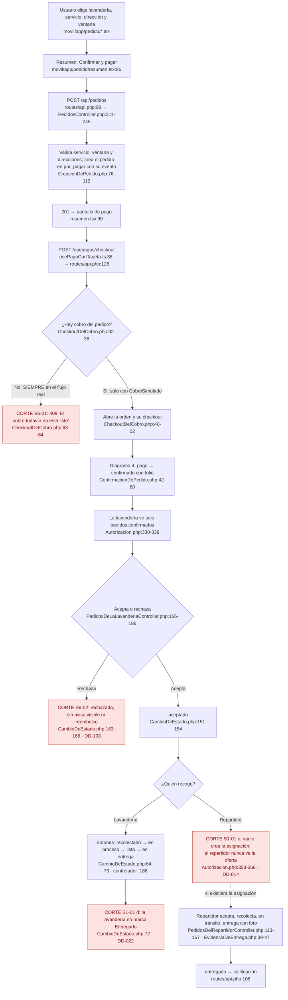
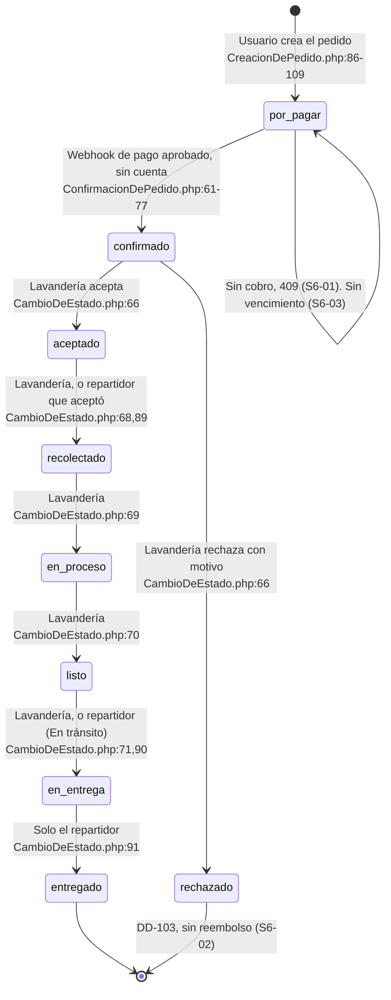

# Auditoría Lavandi — Segmento 6: flujos ya programados

**Objeto:** rama `arthur/feat/h3-concilio` (PR #4) · SHA `9d24977` · fecha de corte 2026-11-24.

**Qué NO se revisó:**
- **No se corrieron pruebas.** Donde un tramo dice "con test", quiere decir que hay una prueba escrita que lo declara.
  Que esté en verde: NO VERIFICADO.
- **No se ejecutó la app ni el servidor.** Los diagramas salen de leer el código. Son **reconstruidos desde código**,
  no son diseño, y describen lo que el código haría, no lo que se vio pasar.
- Solo cuatro flujos, los que pide el encargo: registro e inicio de sesión, pedido de punta a punta, estados del pedido
  y pago. Quedan fuera la recuperación de contraseña, el borrado de cuenta, el alta de la lavandería desde la app, la
  calificación, el soporte y todo el panel.
- La seguridad de estos flujos está en el segmento 4, y las integraciones en el segmento 5. Aquí solo se citan.

**Veredicto: NO ESTÁ LISTO.**
- Cada tramo está bien construido: hay una sola tabla de transiciones, cada cambio se hace con el pedido bloqueado, los
  avisos salen después de guardar y el webhook procesa cada aviso una sola vez.
- Pero el pedido no llega de punta a punta con datos reales. **El primer corte está antes de Conekta:** ningún código
  de producción crea el cobro del pedido, así que pagar responde 409 en todos los pedidos que se crean desde la app.
- Después de ese corte vienen los que ya reportó el segmento 1: nadie asigna repartidor y la lavandería no marca
  Entregado. Ninguna prueba recorre el flujo completo.

### Resumen
- **El pedido se corta en el pago, y no por Conekta** (S6-01). `CreacionDePedido` deja el pedido en `por_pagar` sin
  cobro, y el único código que crea un cobro es el simulado de desarrollo. Está documentado y probado como pendiente de
  DD-012, pero el segmento 1 no lo listó como corte.
- **Un pedido rechazado deja al usuario sin dinero y sin aviso** (S6-02). Ya pagó; el pedido pasa a `rechazado`, la app
  no lo nombra, no hay aviso visible y no hay reembolso. Espera DD-103.
- **Los cobros no vencen** (S6-03). Conekta manda `order.expired` y el servidor lo traduce, pero no lo aplica. Los
  pedidos `por_pagar` se quedan para siempre.
- **No hay prueba del recorrido completo** (S6-04). Cada tramo tiene sus pruebas, y las del pago fabrican el cobro con
  la herramienta de desarrollo.
- **Corrección al segmento 1** (S6-05): el repartidor **sí** puede obtener su cuenta. Se registra solo y la
  administración lo da de alta. La que no tiene vía es la lavandería.

### Hallazgos
| ID | Severidad | Área | Hallazgo | Evidencia (grado + ruta:línea) | Impacto | Recomendación |
|---|---|---|---|---|---|---|
| S6-01 | Alta | Pedido y pago | **Ningún código de producción crea el cobro del pedido.** `crear()` guarda el pedido en `por_pagar`, su servicio, sus direcciones y su evento, pero ningún `Pago`. Al pedir el checkout, `CheckoutDelCobro` no encuentra cobro y responde 409 "El cobro de este pedido todavía no está listo.". El único `Pago::create` del código está en `CobroSimulado`, que solo sirve con la pasarela simulada. Está documentado como pago-E14, que espera DD-012, y hay una prueba que fija el 409 | B: `servidor/app/Pedidos/CreacionDePedido.php:82-112`; `servidor/app/Cobro/CheckoutDelCobro.php:63-64`; `servidor/app/Cobro/CobroQueNoSePaga.php:19,42`; `servidor/app/Cobro/Desarrollo/CobroSimulado.php:60-71,98-104`; `openspec/changes/pago/tasks.md:56`; test `servidor/tests/Feature/Pago/CrearCheckoutTest.php:206`. A: `NSV-2026-001-v8.pdf:21:ANEXO A, Sección A.4.3` | Ningún pedido creado desde la app se puede pagar, aunque Conekta quede terminada. Bloquea A43-2. Es el primer corte del flujo y no depende de DD-102 | Llevar DD-012 a EL CLIENTE con fecha: sin el monto no hay cobro. Mientras tanto, que el plan de sprints lo muestre como bloqueo del pago y no como "falta Conekta" |
| S6-02 | Media | Pedido y pago | **El pedido rechazado por la lavandería deja al usuario sin servicio, sin aviso y sin reembolso.** El rechazo solo llega a pedidos `confirmado`, que ya están pagados. `rechazado` está fuera de los cinco pasos y no es visible: la app no marca ningún paso como actual y el aviso al teléfono no es visible. El cobro queda `pagado` y no hay código de reembolso (pago-E16) | B: `servidor/app/Pedidos/CambioDeEstado.php:66,163-166`; `servidor/database/migrations/2026_11_22_110000_sembrar_estado_rechazado.php:24-27`; `movil/src/estados/seguimiento.ts:25`; `servidor/app/Avisos/AvisarAlUsuario.php:15-16`; `openspec/changes/pago/tasks.md:58`; test `servidor/tests/Feature/PedidosLavanderia/RechazarTest.php:59`. C: DD-103 en `vault/meta/deuda-de-decision.md:114` | El usuario pagó y ve su pedido como si siguiera sin confirmar. Si ocurre en el piloto, es un reclamo directo a EL CLIENTE | Resolver DD-103 antes de abrir el rechazo a socios reales. Mientras tanto, que la operación sepa cómo devolver el dinero a mano |
| S6-03 | Baja | Pago | **Los cobros no vencen y los pedidos `por_pagar` no se cierran.** `PasarelaConekta` traduce `order.expired` a `vencido`, pero `EfectoDelAviso` solo aplica aprobado y rechazado. Ningún código escribe `Pago::VENCIDO` ni `Pago::CANCELADO`, y no hay tarea programada que limpie pedidos sin pagar. La rama "ya no se puede pagar" de la app nunca se alcanza | B: `servidor/app/Cobro/PasarelaConekta.php:146`; `servidor/app/Cobro/EfectoDelAviso.php:32-34`; `servidor/app/Models/Pago.php:42,48`; `servidor/routes/console.php` (solo poda `Exportacion`); `movil/src/pago/useEsperaDelCobro.ts:62-63`. C: DD-056 y DD-012 (pago-E13 y E20, `openspec/changes/pago/tasks.md:55,59`) | Pedidos `por_pagar` y cobros `pendiente` se acumulan. La conciliación tendrá que distinguir los abandonados a mano | Cuando DD-012 fije el cobro, decidir en el mismo ADR qué pasa con un pedido que no se paga y aplicar el aviso `vencido` |
| S6-04 | Media | Pruebas | **Ninguna prueba recorre el pedido de punta a punta.** Cada tramo tiene las suyas: crear (`Confirmacion/`), pagar (`Pago/`), aceptar y marcar (`PedidosLavanderia/`, `Estados/`) y repartir (`Repartidor/`). Las del pago crean el cobro con el código de desarrollo, por eso no ven el corte de S6-01. En la app, el único flujo de Maestro cronometra un cambio de estado y prepara su pedido con el cobro simulado (corregido en S8-03) | B: `servidor/tests/Feature/Confirmacion/Soporte/PedidosDePrueba.php:142` es el único que hace `POST /api/pedidos`, y ninguna prueba que lo usa llega a `entregado`; `servidor/app/Cobro/Desarrollo/CobroSimulado.php:15-21`; `movil/.maestro/estados/cambio-en-60-segundos.yaml:1-16` y `movil/.maestro/estados/preparar-pedido.ps1:5-8` | Un corte entre tramos, como S6-01, pasa con todas las suites en verde | Una prueba de integración por flujo que encadene las rutas reales, y que hoy falle de forma explícita donde falta una decisión |
| S6-05 | Info | Corrección | **Corrección a S1-01 (e).** El segmento 1 dijo que "ningún socio puede obtener su cuenta". El repartidor sí puede: la ruta pública crea la cuenta con rol `repartidor`, pendiente de alta, y el panel tiene "Dar de alta". Sigue siendo cierto para la lavandería: su registro exige una cuenta que ya tenga el rol `lavanderia`, y nada lo asigna | B: `servidor/routes/api.php:43`; `servidor/app/Repartidores/RegistroDeRepartidor.php:51-52`; `servidor/app/Filament/Resources/Repartidores/Actions/AccionesDeEstado.php:36-53`; `servidor/routes/api.php:137`; `servidor/app/Identidad/AltaDeCuenta.php:28` | S1-01 sigue siendo Alta por las otras cuatro causas | Se corrigió la fila S1-01 del informe del segmento 1 y del tablero |
| S6-06 | Info | Positivos | **Cada tramo está bien construido.** Una sola tabla de transiciones por actor. Cada cambio bloquea el pedido (`lockForUpdate`) y deja su evento en la misma transacción. Los eventos de aviso salen después de guardar. El aviso de la pasarela se registra una vez y se procesa una vez. El token de la app va en el almacén cifrado del teléfono | B: `servidor/app/Pedidos/CambioDeEstado.php:64-92,215-242`; `servidor/app/Pedidos/ConfirmacionDePedido.php:42-80`; `servidor/app/Pedidos/EstadoDelPedidoCambiado.php:23`; `servidor/app/Pedidos/PedidoConfirmado.php:18`; `servidor/app/Cobro/RecepcionDeAvisos.php:62-69,81-85`; `movil/src/sesion/almacen.ts:11-17` | — | Conservar |

**Ya reportados, que aparecen en los diagramas:**
- **S1-01:** (c) nadie crea la asignación del repartidor; (d) la lavandería no marca Entregado.
- **S1-05:** Google Sign-In y los avisos no funcionan en iPhone.
- **S1-11:** Conekta no autentica el webhook y no ofrece OXXO.
- **S4-01:** la entrada con Google da token a la cuenta de administración.
- **S5-01 y S5-02:** en producción faltan los paquetes de S3 y de Resend. Sin Resend, el correo de confirmación no sale.

### Diagrama 1 — Registro e inicio de sesión (reconstruido desde código)

```mermaid
sequenceDiagram
    autonumber
    participant App as App (movil/)
    participant API as Servidor (api.php)
    participant G as Google

    Note over App: Arranque: con sesión va al inicio de su módulo;<br/>sin sesión, a bienvenida o inicio de sesión<br/>movil/app/index.tsx:28-34
    App->>App: Lee token y rol del almacén cifrado<br/>src/sesion/ProveedorDeSesion.tsx:50-88
    alt Registro con correo
        App->>API: POST /api/registro<br/>src/acceso/api.ts:37 → routes/api.php:36
        API->>API: Alta con rol usuario<br/>RegistroController.php:20 → AltaDeCuenta.php:21-31
        API-->>App: 201 token + usuario<br/>RegistroController.php:22-25
    else Inicio con correo
        App->>API: POST /api/sesion<br/>src/acceso/api.ts:42 → routes/api.php:37
        API->>API: Timebox, contraseña, bloqueo<br/>SesionController.php:55-74
        API->>API: Solo roles de la app (403 a la administración)<br/>SesionController.php:77-81
        API-->>App: token + usuario<br/>SesionController.php:83-86
    else Inicio con Google
        App->>G: One Tap → idToken<br/>src/acceso/google.ts:39-53
        Note right of App: CORTE en iPhone (S1-05)
        App->>API: POST /api/sesion/google<br/>src/acceso/api.ts:73 → routes/api.php:40
        API->>G: Verifica el idToken<br/>EntradaConGoogle.php:47
        API->>API: Liga o crea cuenta; si existía,<br/>anula su contraseña y sus tokens<br/>EntradaConGoogle.php:60-87,110-113
        Note right of API: Sin filtro usaLaApp (S4-01)
        API-->>App: token + usuario<br/>SesionConGoogleController.php:29-32
    end
    App->>App: 403 = "sin acceso a la app"<br/>src/acceso/api.ts:80
    App->>App: Guarda rol y token y abre el módulo<br/>ProveedorDeSesion.tsx:148-160 · useEntrada.ts:45-48
    opt Repartidor
        App->>API: POST /api/repartidor/registro<br/>src/repartidor/api.ts:79 → routes/api.php:43
        API->>API: Cuenta con rol repartidor, pendiente de alta<br/>RegistroDeRepartidor.php:51-52
        Note right of API: La administración lo da de alta en el panel<br/>AccionesDeEstado.php:36-53
    end
    Note over App,API: Lavandería: CORTE. No hay ruta que dé el rol lavanderia (S1-01 e)
```

**Tests:** servidor, `tests/Feature/Registro/` (`RegistroConCorreoTest`, `SesionTest`, `GoogleTest`,
`CuentaDeLosRolesDeLaAppTest`, `LimiteDeIntentosTest`) y `tests/Feature/Repartidor/RegistroTest.php`; app,
`movil/__tests__/registro/` y `movil/__tests__/sesion/`. **Falta test:** no hay prueba de que la entrada con Google
rechace a la cuenta de administración. Es S4-01: hoy no la rechaza.

### Diagrama 2 — Pedido de punta a punta (reconstruido desde código)



**Tests por tramo:** creación en `tests/Feature/Confirmacion/CrearPedidoTest.php`; checkout en
`tests/Feature/Pago/CrearCheckoutTest.php`, incluido el 409 sin cobro (`:206`); aceptar y rechazar en
`tests/Feature/PedidosLavanderia/`; botones en `tests/Feature/Estados/BotonesDeLaLavanderiaTest.php`; repartidor en
`tests/Feature/Repartidor/`. **Falta test:** ninguno encadena los tramos (S6-04).

### Diagrama 3 — Estados del pedido (reconstruido desde código)



- **Los que ve el usuario:** son cinco, `confirmado`, `recolectado`, `en_proceso`, `listo` y `entregado`
  (`servidor/database/migrations/2026_11_21_400000_crear_estados_y_pedidos.php:34-40`).
  - `aceptado` y `en_entrega` comparten el orden de un paso visible, y el usuario los ve como ese paso
    (`2026_11_22_100000_sembrar_estado_aceptado.php:25-26`, `2026_11_22_120000_sembrar_estado_en_entrega.php:26-27`).
  - `por_pagar` y `rechazado` no son visibles
    (`2026_11_21_410000_sembrar_estado_por_pagar.php:20-23`, `2026_11_22_110000_sembrar_estado_rechazado.php:24-27`).
- **Cómo se hace cada cambio:** con el pedido bloqueado y su evento en la misma transacción. Un cambio que no está en la
  tabla responde `CambioDeEstadoNoPermitido` y el pedido no cambia (`CambioDeEstado.php:215-242`).
- **Tests:** `tests/Feature/Estados/` (`BotonesDeLaLavanderiaTest`, `QuienMueveElPedidoTest`, `EstadoVisibleTest`,
  `SinPagoTest`), `tests/Feature/Repartidor/EstadosDelRepartidorTest.php` y `tests/Feature/Confirmacion/ConfirmarPedidoTest.php`.
- **Falta test:** no hay prueba de lo que ve el usuario en el seguimiento cuando su pedido está `rechazado`. La del
  servidor solo fija que no tiene paso (`RechazarTest.php:59`).

### Diagrama 4 — Pago (reconstruido desde código)

```mermaid
sequenceDiagram
    autonumber
    participant App as App (movil/)
    participant API as Servidor
    participant P as Pasarela (simulada o Conekta)

    App->>API: POST /api/pagos/checkout {pedido, metodo}<br/>src/pago/api.ts:55 → PagosController.php:52-70
    API->>API: Pedido propio o 404; solo tarjeta (DD-056)<br/>PagosController.php:58-59,97-107
    API->>API: Bloquea el cobro y lo revisa<br/>CheckoutDelCobro.php:31-38,61-74
    Note right of API: CORTE S6-01: sin cobro → 409
    API->>P: Reusa el checkout vigente o crea una orden<br/>CheckoutDelCobro.php:40-47
    API-->>App: {checkout.url, regreso, pago}<br/>PagosController.php:63-69
    App->>P: Abre el checkout en el navegador del sistema<br/>src/pago/checkout.ts:19-29
    App->>App: Pantalla de espera<br/>usePagoConTarjeta.ts:52
    P->>API: POST /api/pasarela/avisos (webhook)<br/>routes/api.php:52 → AvisosDeLaPasarelaController.php:29-34
    API->>API: Comprueba autenticidad<br/>RecepcionDeAvisos.php:42-44
    Note right of API: CORTE con Conekta: esAutentico lanza excepción (S1-11, DD-102)
    API->>API: Registra el evento una vez, lo procesa una vez<br/>RecepcionDeAvisos.php:46-51,62-69,81-89
    alt Aprobado
        API->>API: Cobro pagado<br/>EfectoDelAviso.php:49-59
        API->>API: Confirma el pedido con folio<br/>EfectoDelAviso.php:62-64 → ConfirmacionDePedido.php:42-80
        API->>App: Aviso FCM y correo, después del commit<br/>PedidoConfirmado.php:18 · AppServiceProvider.php:39,43
        Note right of API: Correo sin Resend en producción (S5-02); FCM apagado en iPhone (S1-05)
    else Rechazado
        API->>API: Cobro fallido<br/>EfectoDelAviso.php:69-75
    else Vencido u otro
        API->>API: Se ignora<br/>EfectoDelAviso.php:32-34
        Note right of API: S6-03
    end
    loop Cada 5 s, hasta 3 min
        App->>API: GET /api/pagos/{pago}<br/>src/pago/api.ts:85 → PagosController.php:76-89
    end
    App->>App: pagado → confirmación · fallido → reintentar<br/>useEsperaDelCobro.ts:58-63 · procesando/[cobro].tsx:39-41
    App->>App: A los 3 min: "en revisión"<br/>useEsperaDelCobro.ts:25,74
```

**Tests:**
- Servidor: `tests/Feature/Pago/`, con `CrearCheckoutTest`, `PagoAprobadoTest`, `PagoRechazadoTest`,
  `PagoConfirmaElPedidoTest`, `SoloElWebhookConfirmaTest`, `WebhookUnaSolaVezTest` y `PasarelaConektaTest`.
- App: `movil/__tests__/pago/abrir-checkout.test.tsx` y `procesando-pago.test.tsx`.

**Falta test:**
- La autenticidad del aviso de Conekta (tarea 3.1 sin hacer, `openspec/changes/pago/tasks.md:36`).
- La orden contra el sandbox (tarea 3.3, `:42`).
- El aviso `vencido` (S6-03).

### Dónde se corta cada flujo
| Flujo | Corte | Hallazgo | Espera |
|---|---|---|---|
| Registro e inicio de sesión | Google en iPhone | S1-05 | Configuración de iOS |
| Registro e inicio de sesión | La lavandería no tiene cómo obtener su cuenta | S1-01 (e), corregido en S6-05 | DD-053 |
| Pedido | Pagar responde 409: no hay cobro | **S6-01** | DD-012 |
| Pedido | Rechazo sin aviso ni reembolso | **S6-02** | DD-103 |
| Pedido | Nadie asigna repartidor | S1-01 (c) | DD-014 |
| Pedido | La lavandería no marca Entregado | S1-01 (d) | DD-022 |
| Pago | Webhook de Conekta no autentica; sin OXXO | S1-11 | DD-102, DD-056 |
| Pago | Cobros sin vencimiento | **S6-03** | DD-012, DD-056 |
| Avisos del pago | Sin correo en producción; sin FCM en iPhone | S5-02, S1-05 | Instalar Resend; configurar iOS |

### Preguntas abiertas
**Para Arthur:**
- ¿Hay una prueba, fuera de este SHA, que cree un pedido por `POST /api/pedidos` y lo lleve hasta `entregado`? Si no
  la hay, ¿cabe en el sprint una por flujo, que falle donde falta una decisión?
- ¿Cómo se documenta en el plan de sprints que el pago está bloqueado por DD-012 antes que por Conekta?

**Para Nadir:**
- DD-012, el modelo de cobro, ¿tiene fecha de respuesta de EL CLIENTE? Sin ella no hay cobro, aunque Conekta esté
  terminada.
- Mientras DD-103 siga abierta, ¿el piloto abre el rechazo a lavanderías reales? Si lo abre, ¿quién devuelve el dinero
  y cómo?

**Para EL CLIENTE, vía Nadir:** DD-012 (cuándo y cuánto se cobra), DD-103 (qué pasa con un pedido rechazado y su
pago), DD-014 (quién asigna al repartidor) y DD-022 (quién marca Entregado).

### Comandos ejecutados
```bash
# Worktree de solo lectura en el SHA auditado
git -c core.longpaths=true worktree add --detach <scratchpad>/h3 9d24977

# Estados y transiciones
cat -n servidor/app/Pedidos/CambioDeEstado.php
grep -n "const" servidor/app/Models/EstadoPedido.php servidor/app/Models/Pago.php
grep -nE "'codigo' =>|visible_usuario|'orden'" servidor/database/migrations/2026_11_2[12]_*estado*.php

# Pedido y pago en el servidor
cat -n servidor/app/Pedidos/CreacionDePedido.php servidor/app/Pedidos/ConfirmacionDePedido.php
cat -n servidor/app/Cobro/CheckoutDelCobro.php servidor/app/Cobro/EfectoDelAviso.php servidor/app/Cobro/RecepcionDeAvisos.php
grep -rn "new Pago\|Pago::create\|pagos()->create" servidor/app servidor/database
grep -rn "Pago::VENCIDO\|Pago::CANCELADO\|EventoPasarela::VENCIDO" servidor/app

# Acceso
cat -n servidor/app/Http/Controllers/Api/SesionController.php servidor/app/Identidad/EntradaConGoogle.php
grep -nE "Route::(post|get)" servidor/routes/api.php

# App
cat -n movil/app/index.tsx movil/src/acceso/useEntrada.ts movil/src/sesion/almacen.ts
cat -n movil/src/pago/usePagoConTarjeta.ts movil/src/pago/checkout.ts movil/src/pago/useEsperaDelCobro.ts
sed -n '1,30p' movil/src/estados/seguimiento.ts

# Pruebas por tramo
grep -rlE "postJson\(['\"]/?api/pedidos['\"]" servidor/tests
grep -nE "TestDox" servidor/tests/Feature/Pago/CrearCheckoutTest.php
```
